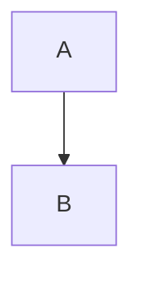

# わざとまちがえた見本（架空の例）
> ひとことで：書きまちがいがあっても、読める所は図になる

```流れ　手続き
申しこみ　→　確認　⇒　受付
確認 ー> 返事：OK
-> だれもいない
受付 ！急ぎ
```

```日程
2026/12/1　説明会
12/15 締め切り ！期限
2026-13-40 ない日
あした 何か
```

```数字 件数（件）
１月 ： １２０
2月 : 1.2万
3月 : たくさん
```

```比べる
| 項目 | 案A | 案B |
| 値段 | ○ | × | 余り |
```


